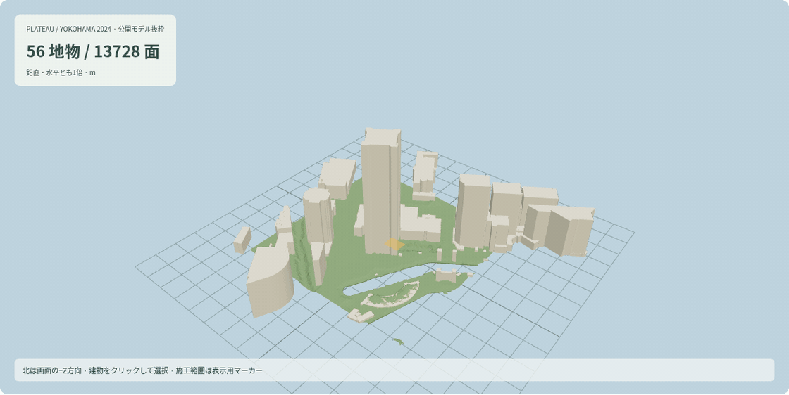
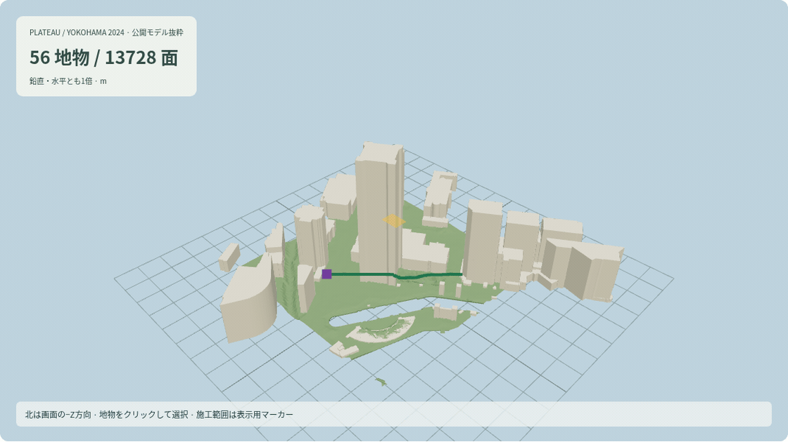
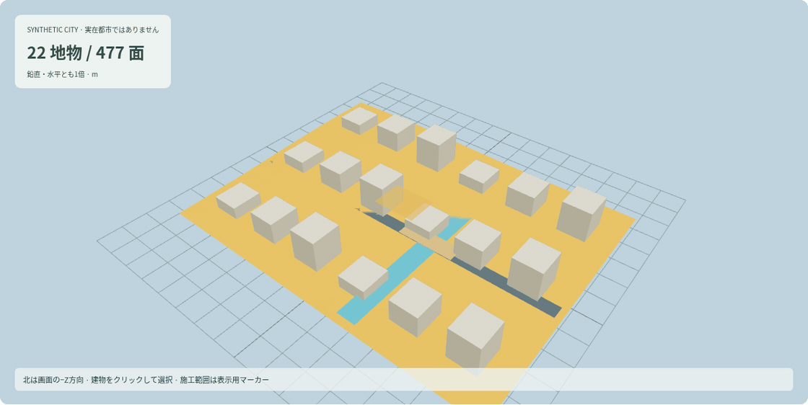
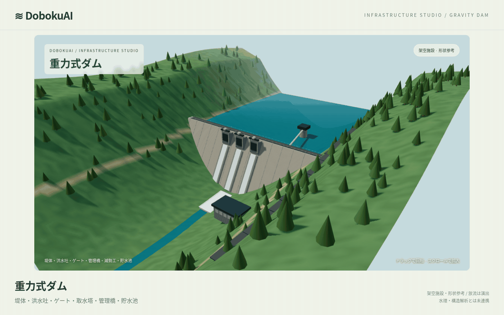
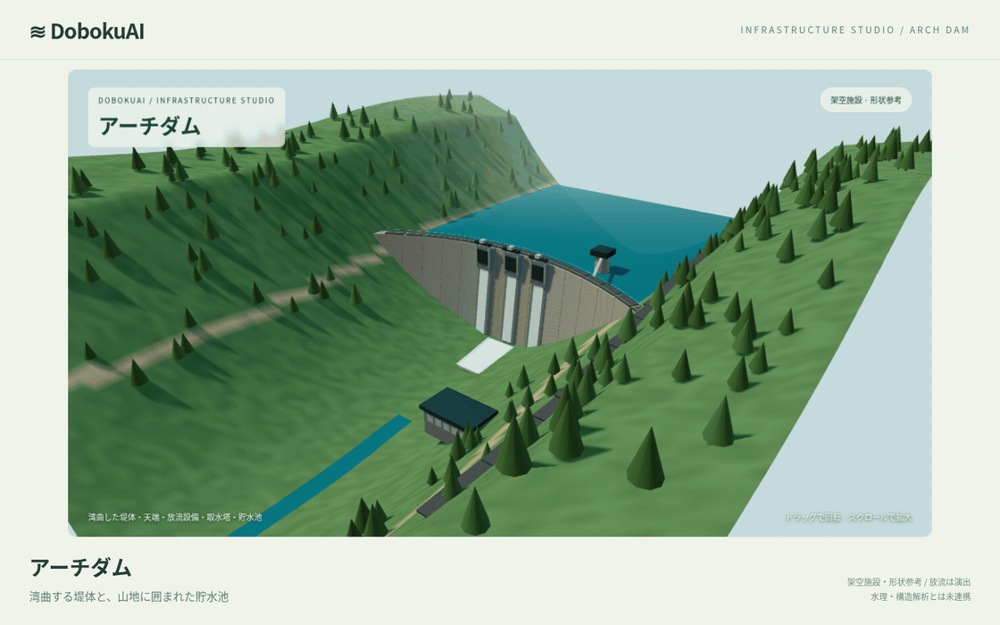
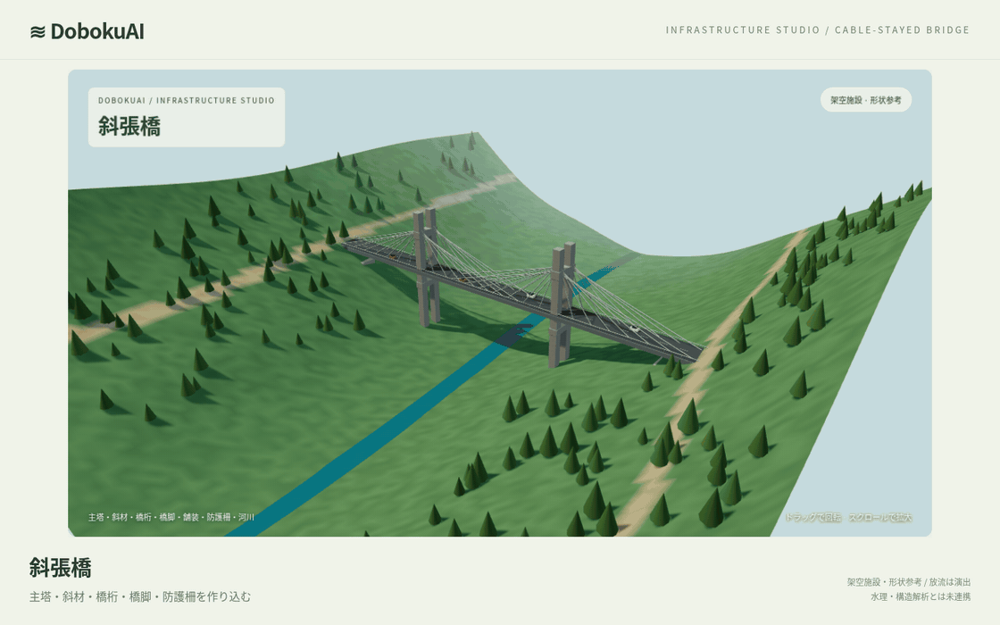
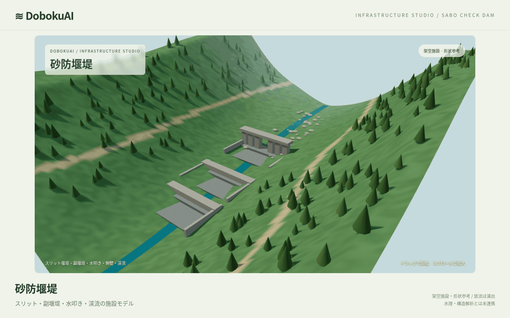
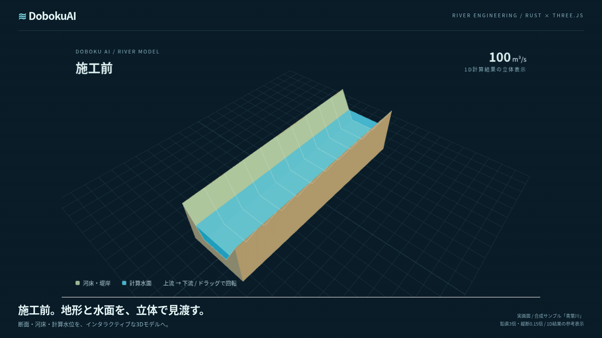
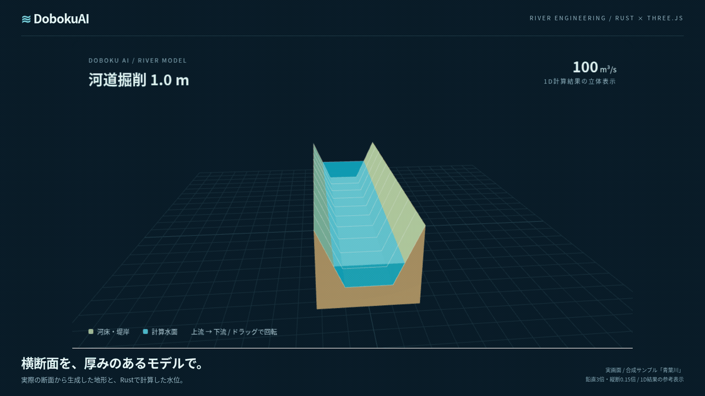
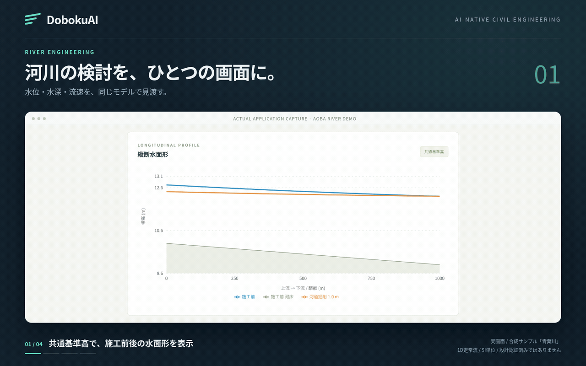

# DobokuAI

[](https://github.com/rsasaki0109/DobokuAI/actions/workflows/check.yml)

AI-native Civil Engineering Platform の **河川エンジニアリング MVP**。
Rust の決定論的な水理エンジンと、条件を整理する AI 操作提案を分離しています。
ブラウザで横断面を編集し、1 次元定常不等流を計算して、施工前後の水面形・土量を比較できます。
現時点では設計認証済みのソフトウェアではありません。利用権を付与する OSS ライセンスは設定していません。
[利用条件](NOTICE.md) · [GitHub公開の確認記録](docs/publication.md)

施設ギャラリーには、ダム・橋梁・砂防の架空の3D形状モデルを追加しています。
別画面の **「ダム予備照査」** で、自由越流容量・静水圧・自重・揚圧・滑動比・転倒比・基礎接触をRustで計算できます。
施設ギャラリーの形状とは未連携です。アーチ・橋梁・砂防の構造計算は未実装です。


**断面をつくる → Rust で計算する → 改修案を比較する → 成果を残す。**

[起動する](#起動) · [機能と操作](#操作) · [計算の検証](docs/validation.md)

横断測量CSVはm・国際ft・US Survey Footに対応し、距離と高さを別の単位で指定できます。
反映前に[粗度の置換・引き継ぐ流量や境界水深・新しい境界水位](docs/survey-import.md#反映前の条件確認)を確認できます。
[距離m・高さUS Survey Footの合成サンプル](examples/synthetic-mixed-units.csv)と[取込み仕様](docs/survey-import.md)。
水理計算画面では[共通基準高の境界水位から水深を入力](docs/boundary-water-level.md)できます。
常流は下流端、射流は上流端の河床を使い、境界位置・河床標高・標高系を確認できます。
[断面形式の切替](docs/section-conversion.md)は変更候補の確認後に反映します。垂直岸を測量点へ変換するための座標補正は行いません。
CSV取込みや施工案削除で断面が入れ替わると、未反映の測量点下書き・エラーを破棄して新しい断面を表示します。

## 都市・地形3D — CityGML取込み

**「都市・地形3D」** でCityGMLを点検・確認して取り込み、建物・地形・道路・橋・水域を表示できます。
レイヤー切替、視点・夕景・地物選択、確認付き施工範囲マーカーと表示条件JSONに対応。
表示条件JSONを読み戻し、同じモデルを照合してから施工範囲・レイヤー・表示モードを復元できます。
画面を離れる前に保存し、戻ったら「都市の表示条件を復元する」で確認してください。
初期画面は **横浜・みなとみらい（PLATEAU 2024）**。原配信から取得した建物38件と実地形の抜粋を、
CC BY 4.0の出典・加工記録付きで同梱しました。[データ記録](apps/web/src/data/yokohama/README.md)。
[合成都市](examples/synthetic-city.gml)にも切り替えられます。施工範囲は表示専用で、土量・浸水計算とは未連携です。
[操作・対応する座標系・制約](docs/city-workspace.md)。



出典：国土交通省 Project PLATEAU（横浜市2024年度）。表示用に加工して作成、
[CC BY 4.0](https://creativecommons.org/licenses/by/4.0/)。水理・構造計算とは未連携です。

反映済み範囲の中心を通る東西・南北の地形断面を、図・CSV・単体HTMLで確認できます。
断面は3Dにも重ねて表示でき、「地形断面を近くから見る」で位置と起伏を確認できます。
図のクリック・距離入力・交点選択で座標と標高候補を照会し、一意な高さの位置を3Dの紫の点で確認できます。
計画標高を確認すると、2線の切土・盛土断面積をRustで計算し、同じ基準高の図とHTML/CSV/JSONで残せます。
保存した計算JSONは、同じ断面・出典とRust再計算結果を照合し、確認後に元の計算日時で開き直せます。
計画標高を変えた2案を同じ座標・縦軸で比較し、切土・盛土の面積差と両案の条件をHTML/CSV/JSONへ出力できます。
比較JSONも元断面・出典・両案のRust再計算に照合して開き直せます。元の日時と欠損判定を保持し、現在の計算条件は変更しません。
最大9個の計画標高をまとめて計算し、切土・盛土の変化を表と散布図で比較できます。失敗ケースも記録し、成功案の断面図は追加計算なしで確認・保存できます。
欠損・複数高さがある軸は全長の面積を未算定とし、一意な区間の小計を示します。体積への換算は行いません。[計算法と制約](docs/city-grading.md)。
東西は緑・南北は青。元の地形高さを保持し、欠損や一意でない高さの区間をつなぎません。
断面HTMLは画面と共通の図、欠損・複数高さの判定、出典を記録し、同じ条件・作成日時のCSVも内包します。
[断面の内容](docs/city-workspace.md#中心を通る地形断面東西南北)。

任意の2点を結ぶ斜め・逆向きの地形断面も、点検・確認して表示できます。
距離・交点・図のクリックで座標と高さ候補を照会し、一意な位置を3Dの紫の点で確認できます。
指定線の3D重ね表示・近接表示も使えます。中心2線とは切り替えて表示します。
元の東・北座標、原標高、欠損と高さ候補、出典・ファイルハッシュをHTML/CSV/JSONへ保存します。
保存した指定線JSONは、同じモデル・施工範囲で全断面を再切断して照合し、確認後に元の日時で開き直せます。
APIキーや計算APIなしで使えます。[任意方向の断面と制約](docs/city-transect.md)。



出典：国土交通省 Project PLATEAU（横浜市2024年度）。表示用に加工して作成、
[CC BY 4.0](https://creativecommons.org/licenses/by/4.0/)。表示地形の確認で、水理・構造計算とは未連携です。

確認済み施工範囲のHTML資料・地形5点CSVも保存できます。[資料の内容](docs/city-workspace.md#確認資料htmlと地形5点csv)。

地形クリックで施工位置の入力候補を選べます。施工範囲の中心・四隅で地形の高さを確認し、中心高さを確認前の標高候補にできます。[操作と制約](docs/city-workspace.md#施工範囲の地形5点確認)。



このGIFは合成都市の実ブラウザ操作です。実都市データの取得・実施設での検証を示すものではありません。

## 3D施設ショーケース

ブラウザの **「3D施設ギャラリー」** でモデルを切り替え、全景・設備詳細・上流側・真上を確認できます。
堤高・貯水位・ゲート開度の形状変更、夕景、全画面、GLBモデルと表示条件JSONの保存に対応。
施設と周辺地形は架空の作例、放流は装飾表現です。[機能と制約](docs/infrastructure-studio.md)。

### 重力式ダム — 堤体から放流設備まで

コンクリート堤体、洪水吐、ゲート、管理橋、取水塔、減勢工、貯水池、管理道路を作り込んだ施設モデル。



### アーチダム — 谷を渡る曲面

湾曲した堤体を上下流から確認。山地・森林・水際を含む貯水池の形状を立体で見る。



### 斜張橋 — 主塔・斜材・橋桁

主塔、ケーブル、橋桁、橋脚、防護柵、舗装、車両の作例。河川と周辺地形を含むシーン。



### 砂防堰堤 — 渓流の施設配置

スリット堰堤、副堰堤、水叩き、側壁、礫、渓流を組み合わせた形状モデル。



## 河川計算の3D Hero


河床・堤岸を厚みのあるモデルにし、Rustで計算した水位から青い水面を描画。
施工前後を切り替え、カメラを回転して断面の形とつながりを確認できます。
GIFは同梱の**合成サンプル「青葉川」**の実画面です。
3Dは1D計算結果の参考表示で、鉛直3倍・縦断0.15倍。定量比較には2D図を使用します。

### 河床と水面、立体で

元の横断面から生成した地形と計算水面を、一周するカメラで見渡す。


### 同じ視点で、施工前後を比較

施工前から1 m掘削案へ。同じ座標・カメラ経路でモデルを切り替え、水位差・概算土量も確認。



### 断面の形を、奥行きとともに

正面寄りの視点から、水面・河床・堤岸の関係と断面の連続性を見る。



## Hero gallery

同梱の**合成サンプル河川「青葉川」**を実際に操作したGIFです。
実河川の測量・検証結果ではありません。AIのデモはAPIキー不要のローカル操作ルールを使用しています。
紹介用の見出し・フレームを添え、図や計算値は実画面をそのまま使っています。

### 01 · 河川の検討を、ひとつの画面に

施工前後の水面形、水深、流速。Rustが計算した分布を、同じ測点で見渡す。


### 02 · 断面を変える。形が見える

底幅と法勾配を編集し、台形から矩形へ。横断形状の変化を大きな図で確認。


### 03 · 改修案を、数値と図で比べる

0.5 m、1 mの掘削案を再計算。同じ基準高の横断図と、水位差・概算土量で比較。


### 04 · 次の検討を、自然言語で

「粗度係数を0.035に変更した場合の水位を比較して」。提案を確認し、Rustで計算して重ねる。


### 05 · 検討の根拠を、成果に残す

保存結果の図付きHTML、流量感度、測点間隔の照査。条件と結果を履歴に残す。


## 詳しい操作デモ

<details>
<summary>9本の実画面GIFで、編集・計算・比較・履歴・出典管理を見る</summary>

### ワークフローの見どころ

断面・水面形・施工比較・AI・成果管理の総集編。3D改良前の実画面を含みます。
最新の施設モデルと河川の3D表示は上のショーケースで確認できます。



### ワークスペースを巡る

ダッシュボードから断面編集、水面形、施工比較、感度比較、アシスタントへ。


### 横断面を編集

底幅・法勾配を変更すると横断図に即座に反映。台形と矩形を切り替え、全測点への形状反映を確認できます。


### 水位・水深・流速を確認

縦断図の表示量を切り替え、測点を選んで施工前後の横断図を確認。同じ基準高で比較します。


### 掘削案と水位・土量を比較

0.5 mと1 mの掘削案を実行し、横断形状・水位差・概算土量を比較します。


### 測点間隔による結果差を照査

線形補間の前提を確認して2分割・4分割を実行。同じ元測点の水位差を比較し、SQLite履歴から元の結果をJSON/CSV/HTMLで保管できます。


### 感度比較から履歴・レポートへ

基本条件を保持して流量・粗度を比較。結果はSQLite履歴に保存し、元の数値・日時でHTML/CSV/JSONに出力できます。


### 自然言語の操作提案を確認して適用

粗度変更の提案を確認してから再計算し、比較図を表示します。条件解釈とRustによる数値結果を区別しています。


### 取込みデータの出典を残す

CSVの出典・利用条件・処理手順を記録し、プレビューを確認して反映。測量日などの未記録項目も成果に残します。


</details>

GIFの撮影・更新手順は [実画面デモの再生成](docs/readme-demos.md) を参照してください。

## 起動

### Docker Compose

Docker Engine + Compose v2 を用意し、リポジトリ直下で実行します。

```sh
docker compose up --build -d
python3 scripts/smoke.py http://127.0.0.1:8080
docker compose logs -f
```

ブラウザでポート **8080** を開きます。初回から青葉川のサンプルと 1 m 掘削案を計算・表示します。
API は Compose 内部で使用し、公開する Web ポートは既定で loopback に限定しています。
SQLite は `river-data` volume に保存します。`docker compose down` はデータを保持します。
Web ポートは `WEB_PORT` で変更できます。

クラウド/社内プロキシで正規 CA が必要な場合は、提供された公開 CA バンドルを指定します。
秘密鍵や API キーをこのファイルに指定しないでください。TLS 検証は常に有効です。

```sh
BUILD_CA_FILE=/path/to/trusted-ca-bundle.pem bash scripts/compose.sh up --build -d
```

BuildKit の CA マウントは任意です。設定がなければ標準の Docker Compose だけでビルドできます。
CAはイメージ層に保存せず、上のスクリプトではAPI実行時も公開CAバンドルを読取り専用でマウントします。
このクラウドでは `BUILD_CA_FILE="$SSL_CERT_FILE"` を使用して検証しています。

### ローカル開発

必要なもの: Rust **1.90.0**（`rust-toolchain.toml`）、Node **24**（Vite は Node 22.12 以上にも対応）、npm、C コンパイラ、Python **3.11以上**。

```sh
cargo build --workspace --locked
npm ci --prefix apps/web
```

別々のターミナルから起動します。

```sh
# ターミナル 1: API / SQLite
cargo run --locked -p doboku-api

# ターミナル 2: Vite（/api を API に転送）
npm run dev --prefix apps/web -- --port 5173 --strictPort
```

ブラウザでポート **5173** を開きます。Linux では `bash scripts/dev.sh` で両方を起動し、機能チェックまで行えます。
Ctrl-C で同スクリプトが起動したプロセスのみを終了します。
クラウド内に Rust が未導入なら `bash scripts/cloud-install.sh` を実行します。
`scripts/run-cargo.sh` は通常の Cargo、またはクラウド用 `/workspace/.toolchains` を選びます。
各タスクの既存チェックアウトを使います。追加の Git worktree は不要です。

## 操作

1. ダッシュボードでサンプルの計算条件と結果を確認。
2. 横断面エディタで測点、標高、粗度、矩形/台形/任意測量断面を編集。全断面への形状反映も可能。
   [下流断面の追加](docs/station-addition.md)は河床標高を入力し、複製形状・粗度と境界水位への影響を確認してから反映します。
   [断面削除](docs/station-deletion.md)も、境界水位・接続後の区間・残る条件を確認してから反映します。
3. 水理計算で流量、境界流況、水深、参照勾配を指定して「計算を実行」。条件変更時は古い結果を表示しません。
4. 施工比較で掘削・断面変更・幅閉塞の仮締切・粗度変更を登録。独立案、または順序付き累積施工段階として最大 6 案を計算。
5. 縦断の水位/水深/流速と同一基準高の横断図で比較。3Dでは地形・水面のモデル、施工前後の切替、斜め/俯瞰/断面、自動回転・全画面を操作できます。参考表示の仕様は [river 3D](docs/river-3d.md)。既定は2Dです。
   「3D施設ギャラリー」は独立した形状作例で、河川条件を変更しません。起動したWebの `/?view=structures` から直接開けます。
6. プロジェクトを保存すると河川条件・施工案・段階モードを SQLite に保存。複製による新規作成と再読込も可能。
7. 「計算を実行」と確認済み AI 操作の成功結果は SQLite の計算履歴に追加。ダッシュボードの「保存結果を開く」で、当時の条件・施工案・段階モード・結果を作業画面に復元します。プロジェクトの保存内容は変更しません。
8. CSV、図入り HTML レポート、再現用 JSON を出力。HTML はブラウザから印刷/PDF 保存可能。保存結果の表示中は元の結果・実行日時で出力します。それ以外の CSV/HTML は現在の条件を再計算します。

履歴はプロジェクト ID ごとに新しい順で 20 件ずつ表示します。未保存の複製にも履歴を作れますが、次回に一覧から選ぶにはプロジェクトも保存してください。
初回表示のサンプル計算、失敗した計算、プレビュー `/compare`、レポートだけの再計算は履歴を作りません。
条件を編集すると保存結果の表示を解除します。再実行は現在のエンジンで新しい履歴を作り、過去の履歴を上書きしません。
履歴の自動削除・保存容量上限・将来の結果スキーマ移行は未実装です。
オンラインバックアップと新規パスへの復元は [recovery](docs/recovery.md) の手順を参照してください。

横断面エディタのCSV取込みは、単位m/国際ft/US Survey Foot・絶対/相対標高・基準高を指定し、プレビュー後に
確認して全測点を置換します。診断があるデータは反映しません。元CSVのハッシュと取込み条件を
プロジェクト・履歴・成果に記録します。データ種別・出典・利用条件・測量日・変換手順も
任意で記録でき、未記録は明示します。利用条件や測量品質の自動認証は行いません。水平CRS/標高基準の変換は未対応です。
[survey-absolute.csv](examples/survey-absolute.csv) は合成サンプルです。
水理計算画面では流量・粗度の感度比較を1〜8条件で行い、失敗案の理由も表示します。
感度比較は専用のSQLite履歴に保存し、過去の比較を元の数値・日時でJSON/CSV/HTML出力できます。
感度履歴を開いても作業中の基本条件は変更しません。CSVの失敗案は数値を空欄にします。
基本断面・境界水深を固定して独立計算し、基本条件を変更しません。
詳細と入力仕様は [survey import / sensitivity](docs/survey-import.md) を参照してください。

水理計算画面の「測点間隔による結果差」では、補間の前提を確認してから区間を2分割・4分割し、
同じ元測点の水位・水深・流速差を比較できます。元の条件・流量・境界を保持し、
追加点は線形補間です。追加測量や実河川の精度保証ではありません。
失敗案は理由を表示し、数値を生成しません。表示結果は日時・エンジン版・補間後の全条件付きJSONと、
元測点での比較CSV・図入りHTMLに出力します。Webの比較はSQLite履歴に保存し、
再読込み後も同じ条件・数値・版・日時で出力できます。履歴を開いても作業中の条件は変わりません。
対応する断面の組合せと検証結果は [測点間隔の比較](docs/station-spacing.md) を参照してください。

## エンジンと適用範囲

### 重力式ダムの水理・構造予備照査

「ダム予備照査」または `/?view=dam` を開き、合成サンプルの寸法・水深・材料重量・摩擦・越流条件を編集できます。
適用範囲を確認して計算すると、断面/荷重図、自由越流容量、滑動/転倒比、基礎の合力と接触圧を表示し、
条件・結果・モデル版・実行日時を独立したSQLite履歴へ保存します。LLMキーは不要です。
「基準に固定」→条件変更→確認・再計算で、同じ局所座標と基礎面z=0で数値と断面を比較できます。
保存履歴は再計算せず復元・JSON/CSV/図入りHTML出力できます。比較表の差は画面表示で、成果は各保存結果を個別に出力します。

対象は上流面鉛直・下流面直線の台形剛体、堤軸方向1 m。
揚圧は全幅線形分布で排水低減なし、摩擦のみ、粘着力0です。部分接触・基礎外の合力・圧縮接触なしを明示し、
適用できない接触圧を出しません。自由越流 `Q=C L H^1.5` は有次元係数の指定式で、潜り越流は拒否します。
非越流部の静力学と自由越流容量は別の理想化モデルです。ゲート放流・洪水調節・越流水荷重の連成・
耐震・FEM・材料強度・設計基準適合は未評価です。例示係数を設計推奨値として扱わないでください。
[モデル・単位・式・検証](docs/dam-calculations.md)。

### 河川の1次元定常計算

単位は SI: 距離・水深・標高 m、面積 m²、土量 m³、流量 m³/s、流速 m/s。
距離は **上流 → 下流** に増加し、標高は全断面で共通のプロジェクト基準高です。

Manning 式:

```text
Q = (1/n) A R^(2/3) sqrt(Sf), R = A/P
Fr² = Q² T / (g A³), g = 9.80665 m/s²
E = z + y + Q²/(2g A²)
E_up - E_down = Δx (Sf_up + Sf_down)/2
```

標準逐次計算法でエネルギー式の根を求めます。指定流況の水深区間を探索し、二分法で解き、連続する水深に近い根を選びます。
二分法は最大 120 回、水深区間幅 10⁻⁹ m、区間エネルギー残差 10⁻⁷ m 以下。有限値・収束・流況を検証します。
常流では **下流端水深**、射流では **上流端水深** が必要です。
施工比較では元の境界水位を固定し、河床変更に伴う境界水深を調整します。
参照勾配は等流水深の診断値に使います。不等流には各測点の実河床標高を使います。
参照勾配を実河床に適用するには UI の専用操作が必要です。

対象は 1 次元定常、単一流路、一定の正の流量、静水圧、エネルギー補正係数 α=1、区間ごとの一様粗度です。
測量断面は x 昇順・最低相対高さ 0。0.2.0では細かな地盤の起伏を平滑化せず保持します。
計算水面が連続する1流路となり、一意な限界水深と同じ連続水深範囲だけを扱います。
潤辺と面積は区分線形断面を水位で切り取って積分します。
限界/等流水深の複数根、段差による不連続、分離する水面を拒否します。[手法と独立照査](docs/irregular-sections.md)。
起伏保持の合成CSVと、ブラウザで試す条件も同ページに記載しています。
水理計算画面の「基本条件を診断」で、全断面の水深範囲・限界/等流水深、幅急変の位置と境界条件を計算実行前に確認できます。
未成立の値は空欄で返し、条件変更後は古い診断を隠します。[診断の読み方・JSON出力](docs/river-diagnostics.md)。
CSV取込みの前には、全断面の横断図・地盤縦断図と全隣接区間を点検できます。
幅急変などで取込みを拒否したCSVも、元点列を表示して理由を確認し、原CSV付きの点検JSONを保存できます。
拒否された形状の反映や部分採用は行いません。[取込み点検の仕様](docs/survey-import.md)。
プロジェクト画面の「試行記録パック」で、保存済みの施工・感度・測点間隔比較をZIPにまとめられます。
基本条件・基準高・版・基本結果が一致する履歴を選び、再計算せずCSV/HTML/JSONとファイルハッシュを出力します。
展開した`index.html`からオフラインで閲覧できます。[収録内容と条件](docs/review-pack.md)。
Python標準ライブラリだけで、成果ZIPのハッシュと保存水深からの水理収支を[オフライン照査](docs/offline-audit.md)できます。
測量CSVはm・国際ft・US Survey Footを明示して取り込めます。元単位・元CSVのハッシュを記録し、計算と図はSIへ換算します。[単位と合成例](docs/survey-import.md)。

次の条件はエラーとなります。

- 入力の非有限値、Q≤0、粗度 n が 0.005〜0.2 の範囲外、断面数が 2〜200 の範囲外。
- 参照勾配が 0 以下または 0.1 を超える、流量が 10⁶ m³/s を超える。
- 測点間隔 0.1 m 未満、実河床勾配の絶対値 >0.1、隣接断面の基準水深での幅変化 >25%。
- 越岸、堤岸内に必要な限界/等流水深が存在しない、指定流況で解が見つからない、残差が許容値を超える。
- 限界流付近（常流 Fr≥0.98 / 射流 Fr≤1.02）、混在する流況。

**跳水・急縮拡・構造物の局所損失・複断面分流・曲線流・横流入・非定常流・土砂移動は未対応。**
幅/勾配のガードだけでは実際の断面遷移が緩やかなことを保証できません。
ユーザーは測量、境界条件、断面遷移、測点間隔を確認し、必要に応じて別の解析モデルと独立照査を使用してください。
河床の逆勾配も実標高として計算できますが、等流水深の参照勾配は正である必要があります。

## 施工・土量モデル

掘削は全測点に適用します（0 < 深さ ≤10 m）。矩形は壁を延長、台形は固定された堤岸へ新しい河床を接続し、測量断面は両岸を固定して内部頂点を下げます。
掘削断面積/盛土断面積は共通 x・基準高の地盤差を積分し、測点間の平均断面法で体積を算出します。掘削と盛土を相殺しません。
測量範囲が一致しない断面変更では、水理比較を行い、土量は理由付きで「未算定」と表示します。
仮締切は矩形/台形の底幅を減らす水理的な代理モデルです。堰・構造物損失・洗掘・安定性・仮締切材料数量を評価しません。
累積モードの水位差/土量は施工前からの累積変化です。土量は施工前後の地盤差であり、中間段階で掘って埋め戻す作業量を合計する機能はありません。
歩掛・単価の根拠が未提供のため、工期・費用は実装していません。

## AI 操作

キーがなくても計算と可視化は全機能動作します。既定はローカル操作ルールです。

- 「流量を100m³/sに変更して再計算して」
- 「粗度係数を0.03に変更した場合の水位を比較して」
- 「河道を1m掘削した場合の水面形を表示して」
- 「施工前後の計算結果をレポートにまとめて」

ローカルモードは曖昧な複数条件を推測せず、1 条件ずつ提案します。
提案は閉じた型付きツール（流量変更、粗度比較、掘削比較、レポート）だけです。
確認ボタンを押すまで条件は変わりません。API も `confirmed: true` を要求します。
計算に失敗した提案は UI の条件に反映されません。適用後の保存はユーザーが明示的に行います。

任意の OpenAI-compatible chat-completions API を使うには `.env.example` を参考に次を設定します。

| 変数 | 内容 |
|---|---|
| `LLM_ENDPOINT` | HTTPS の完全な chat-completions URL |
| `LLM_MODEL` | 使用モデル ID |
| `LLM_API_KEY` | API キー（環境設定から安全に入力） |

通常の Cargo 起動ではプロセス環境に設定、Compose は `.env` を読み込みます。
UI の「ローカル操作ルール」をオフにすると設定済みプロバイダを使用します。未設定ならローカルにフォールバックします。
モデルには自然言語の指示のみを送信します。プロジェクト全体・数値結果は送信しません。
HTTP アダプタは `Provider` インターフェースの一実装です。Anthropic/Gemini の独自形式アダプタは未実装。
LLM 応答は JSON とツール型を検証し、任意コードは実行しません。モデルによる工学的自由作文は計算レポートへ混入させません。
外部 LLM の実認証通信は API キー未設定のため未検証です。
ローカル模擬HTTPサーバーでリクエスト契約・型不適合・認証/レート制限・サイズ超過・タイムアウトを検証します。
これは実プロバイダへのTLS/認証接続の検証とは別です。公開ProviderはHTTPS必須を維持します。

## テストと検証

```sh
cargo fmt --all --check
cargo clippy --workspace --all-targets --locked -- -D warnings
cargo test --workspace --locked
npm run typecheck --prefix apps/web
npm run build --prefix apps/web

# ブラウザを用意（既存 Chromium は CHROMIUM_PATH で指定可能）
cd apps/web
npx playwright install chromium
npm run test:e2e
```

Linux/クラウドでは `bash scripts/check.sh` で一括実行できます。E2E は実 Axum/SQLite と Vite を起動します。
専用ポート 3101/5273 と実行ごとの DB を使用し、既存開発サービスを再利用しません。
`CHROMIUM_PATH=/usr/bin/chromium` を使って検証しました。CI では Chromium をインストールします。
`E2E_BASE_URL`を指定すると既存配布版に対して同じE2Eを実行します。
このテストは合成プロジェクトと履歴を保存するため、専用の試験DBを持つ配布環境で実行してください。

| 対象 | 検証と許容誤差 |
|---|---|
| 矩形限界水深 | 解析解 `(Q² / (g b²))^(1/3)` と 10⁻⁸ m 未満 |
| Manning / 等流水深 | A=20, P=14 の独立評価値、逆計算 10⁻⁸ m 未満 |
| 常流・射流の等流 | 縦断標準逐次計算で一様水深を 10⁻⁷ m 未満で再現 |
| 非一様な常流水面形 | 独立 GVF 微分方程式 RK4 と比較。10 m 間隔の最大水深差 <5×10⁻⁵ m、100 m 間隔より20倍以上改善 |
| 非一様な射流・台形/測量常流・徐拡 | 独立した連続エネルギーODEの6ケース。水深差 <10⁻⁴ mまたは5×10⁻⁵ m、細分化で約25〜64倍改善。測量頂点の水面横断も確認 |
| 外部SWASHESの矩形B1常流/射流 | 重力差を明示的に正規化し、最大水深差 <10⁻⁴m、45→177点で4倍以上改善。外部河床出力も別に細分化検証 |
| 任意測量断面 | 台形の面積/潤辺/水面幅・水面形と一致、不連続限界条件を拒否 |
| 重力式ダム・自由越流 | 矩形の解析解、7独立積分ケースを1e−9×max(1,参照値)以下で照合。部分接触・基礎外・揚圧過大、潜り越流・未知の地震/ゲート項目を診断/拒否 |
| 土量・施工 | 既知の矩形柱 20,000 m³、固定堤岸台形掘削 32,000 m³、正負地盤差、段階施工、仮締切未算定 |
| 都市の切土・盛土断面積 | 解析解・独立中点積分9ケースを1e−6m²未満で照合。横浜の表示断面を独立積分と1e−5m²未満で比較。欠損/曖昧な全長面積は未算定 |
| API | 入力/流況エラー、11 断面結果、SQLite 再接続、段階条件、確認必須ツール、履歴の完全一致・ページング・保存結果の CSV/HTML |
| ブラウザ | 断面編集→流量変更→比較→出力→SQLite再読込、AI確認と越岸拒否、履歴の条件復元・元の日時で出力 |

RK4 参照は `tests/reference_gvf.py`、固定データは `examples/reference-gvf.json`。
`python3 tests/reference_gvf.py` で再生成し、0.05/0.025 m の RK4 刻みの差が 10⁻¹⁰ m 未満であることを確認します。
これはモデルを限定した数値検証です。現地河川の設計妥当性や実測との校正を証明するものではありません。
`docs/validation.md` に実行結果を記録しています。
追加6ケースの条件・誤差・再現方法は [hydraulic reference cases](docs/hydraulic-reference-cases.md) を参照してください。
`python3 tests/reference_cases.py --check` で独立した参照値を再生成照合します。`scripts/check.sh` にも含まれます。
公開SWASHESの外部参照2ケースもCargoテストに含めます。計測された最大水深差は約2.3×10⁻⁵m。
原流量/粗度と正規化した比較条件、外部河床出力の誤差、取得/再生成方法は
[SWASHES validation](docs/swashes-validation.md) を参照してください。外部ツールは製品に同梱しません。
参照の再生成照合はLinux x86_64で `python3 tests/swashes_reference.py --download --check`。
保存済み参照との通常のCargoテストはネットワークなしで実行できます。

## API / 構成

全計算クレートは HTTP・SQLite・LLM を必要とせず単独利用できます。詳細は [architecture](docs/architecture.md)。

```text
apps/web                       React / Vite / Recharts / optional R3F
crates/doboku-core              SI データ型・エラー・サンプル
crates/doboku-geometry          測量断面・潤辺・面積
crates/doboku-hydraulics        Manning・標準逐次計算
crates/doboku-structures        重力式ダムの剛体静力学・基礎接触
crates/doboku-earthwork         掘削/盛土断面積・平均断面法
crates/doboku-planning          施工変換・比較
crates/doboku-agent             型付き提案・Provider
crates/doboku-api               Axum・SQLite・レポート
examples/ tests/ docs/ docker/  データ・独立検証・仕様・配布
```

API は既定で `127.0.0.1:3001`、DB は `.local/doboku.sqlite`。`API_BIND` / `DATABASE_PATH` で変更できます。

| エンドポイント | 操作 |
|---|---|
| `GET /api/health`, `/api/sample` | ヘルス、サンプルプロジェクト |
| `GET/POST /api/projects`, `GET /api/projects/{id}` | プロジェクト一覧・保存・読込 |
| `POST /api/simulate` | River → 条件スナップショット付き Run |
| `POST /api/earthwork/linear-grading` | `{confirmed:true,conditions}` → 水平計画面と2線の切土/盛土断面積。元条件・版・時刻を返し、体積算定/DB保存はしない |
| `GET /api/dams/sample` | 独立した合成ダム条件 |
| `POST /api/dams/runs` | `{conditions,confirmed:true}` → サーバー計算・保存、`{id,run}` |
| `GET /api/dams/runs?before={cursor}` | ダム照査履歴の概要20件 |
| `GET /api/dams/runs/{id}`, `/reports/{csv\|html}` | 元条件・結果・モデル版・実行日時を再計算せず取得 |
| `POST /api/compare` | `{project, scenarios, staged}` → 全結果 |
| `POST /api/imports/survey/preview`, `/apply` | 横断測量CSVの診断・確認後の置換（保存・計算は別） |
| `POST /api/sensitivity` | 基本条件固定の流量/粗度比較、成功と失敗を個別出力 |
| `POST /api/resolution` | `{project, confirmed_interpolation:true}` → 基本計算と2/4分割の結果差（保存なし） |
| `POST /api/resolution/runs` | 確認済みの測点間隔比較をサーバーで計算・保存。`{id,comparison}` |
| `GET /api/projects/{id}/resolution-runs?before={cursor}` | 測点間隔比較の履歴概要を20件 |
| `GET /api/resolution/runs/{id}`, `/reports/{csv\|html}` | 保存した測点間隔結果・成果の取得（再計算なし） |
| `POST /api/sensitivity/runs` | 感度比較をサーバーで計算し、履歴へ保存。`{id,comparison}` |
| `GET /api/projects/{id}/sensitivity-runs?before={cursor}` | 感度履歴の概要を新しい順で20件 |
| `GET /api/sensitivity/runs/{id}` | 保存時の条件・数値・失敗理由・版・日時 |
| `GET /api/sensitivity/runs/{id}/reports/{csv\|html}` | 保存された感度比較の成果出力（再計算なし） |
| `POST /api/runs` | 比較と同じ入力 → 計算成功時に履歴保存、`{id, analysis}` |
| `GET /api/projects/{id}/runs?before={cursor}` | 新しい順の履歴概要20件、`{items, next_before}` |
| `GET /api/runs/{id}` | 保存した条件と数値結果を再計算せず取得 |
| `GET /api/runs/{id}/reports/html`, `/csv` | 保存結果と元の実行日時で出力 |
| `POST /api/agent/propose` | `{prompt, local}` → 型付き提案 |
| `POST /api/agent/apply` | `{project, scenarios, staged, proposal, confirmed}` → 再計算 |
| `POST /api/reports/html`, `/api/reports/csv` | 比較と同じ入力 → 図入り HTML / 全案 CSV |

エンジンの入力/適用範囲エラーは 422、AIの未確認操作は 409、間隔比較の未確認補間は 422、計算過多は 429。
JSON ボディ上限 256 KiB、計算同時実行 4 件。計算は Tokio の blocking pool で実行します。
レポートは全条件、全横断図、縦断水面形、水深/流速、施工比較、注意、エンジンバージョン、UTC 実行日時を記録します。
認証・チーム共有・本番運用監査・河川以外の解析は未実装です。
開発状況と完成度の判断基準は [development status](docs/development-status.md) に記録します。
類似製品との比較、成熟度の評価基準、開発優先順位は [product research](docs/product-research.md) を参照してください。
