# DobokuAI

AI-native Civil Engineering Platform の **河川エンジニアリング MVP**。
Rust の決定論的な水理エンジンと、条件を整理する AI 操作提案を分離しています。
ブラウザで横断面を編集し、1 次元定常不等流を計算して、施工前後の水面形・土量を比較できます。
現時点では設計認証済みのソフトウェアではありません。利用権を付与する OSS ライセンスは設定していません。


**断面をつくる → Rust で計算する → 改修案を比較する → 成果を残す。**

[起動する](#起動) · [機能と操作](#操作) · [計算の検証](docs/validation.md)

## Hero gallery

同梱の**合成サンプル河川「青葉川」**を実際に操作したGIFです。
実河川の測量・検証結果ではありません。AIのデモはAPIキー不要のローカル操作ルールを使用しています。
紹介用の見出し・フレームを添え、図や計算値は実画面をそのまま使っています。

### 01 · 河川の検討を、ひとつの画面に

施工前後の水面形、水深、流速。Rustが計算した分布を、同じ測点で見渡す。

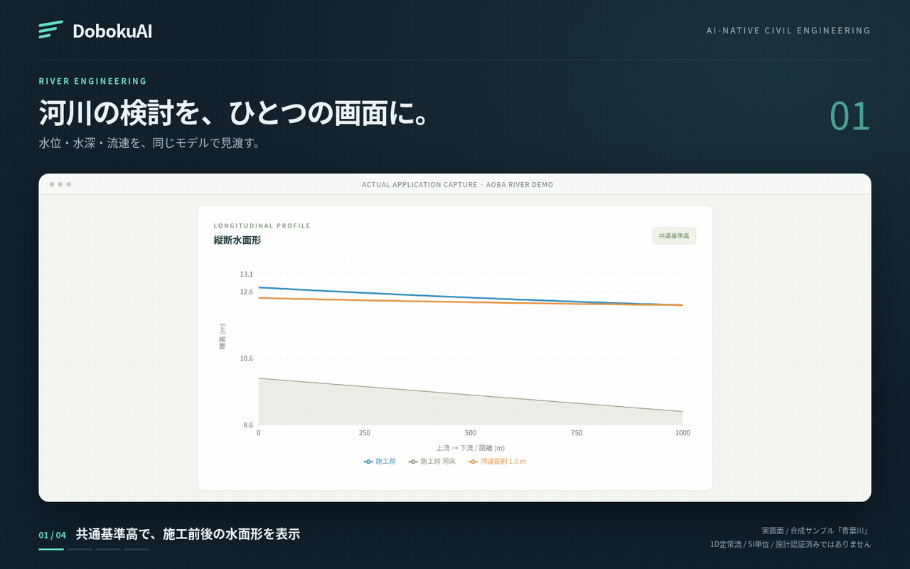

### 02 · 断面を変える。形が見える

底幅と法勾配を編集し、台形から矩形へ。横断形状の変化を大きな図で確認。

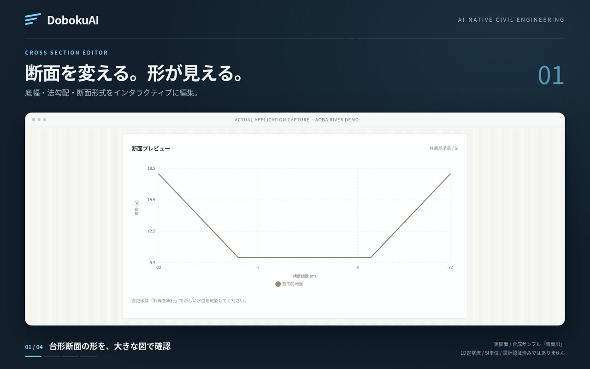

### 03 · 改修案を、数値と図で比べる

0.5 m、1 mの掘削案を再計算。同じ基準高の横断図と、水位差・概算土量で比較。

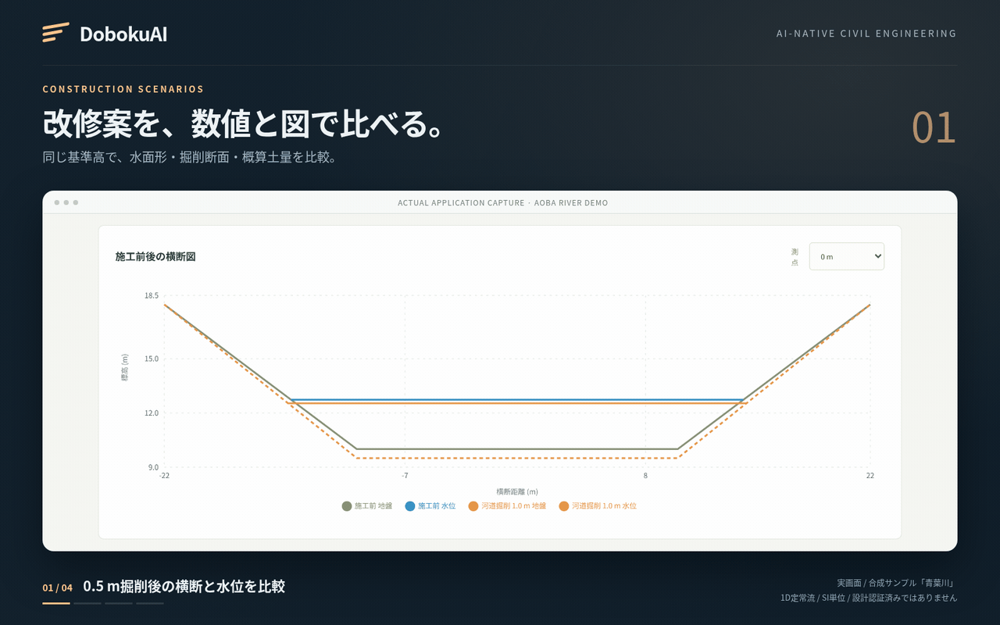

### 04 · 次の検討を、自然言語で

「粗度係数を0.035に変更した場合の水位を比較して」。提案を確認し、Rustで計算して重ねる。

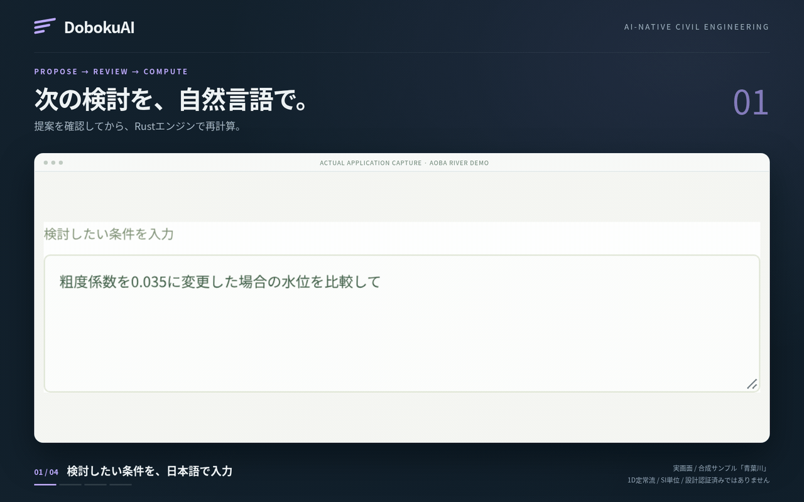

### 05 · 検討の根拠を、成果に残す

保存結果の図付きHTML、流量感度、測点間隔の照査。条件と結果を履歴に残す。

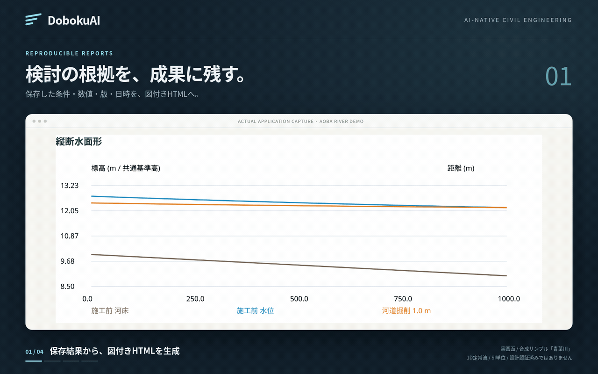

### 06 · 断面のつながりを、立体で

ドラッグで視点を変え、断面の空間的な連続性を確認。鉛直3倍・縦断0.15倍の参考表示で、定量比較には2D図を使用。

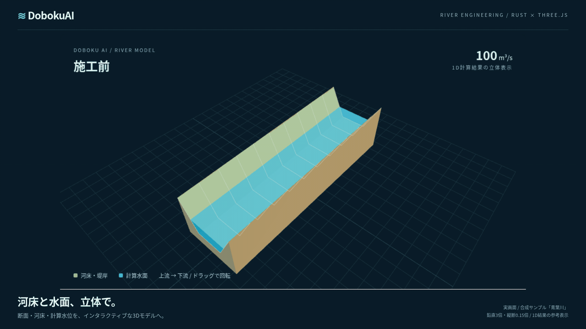

## 詳しい操作デモ

<details>
<summary>8本の実画面GIFで、編集・計算・比較・履歴・出典管理を見る</summary>

### ワークスペースを巡る

ダッシュボードから断面編集、水面形、施工比較、感度比較、アシスタントへ。

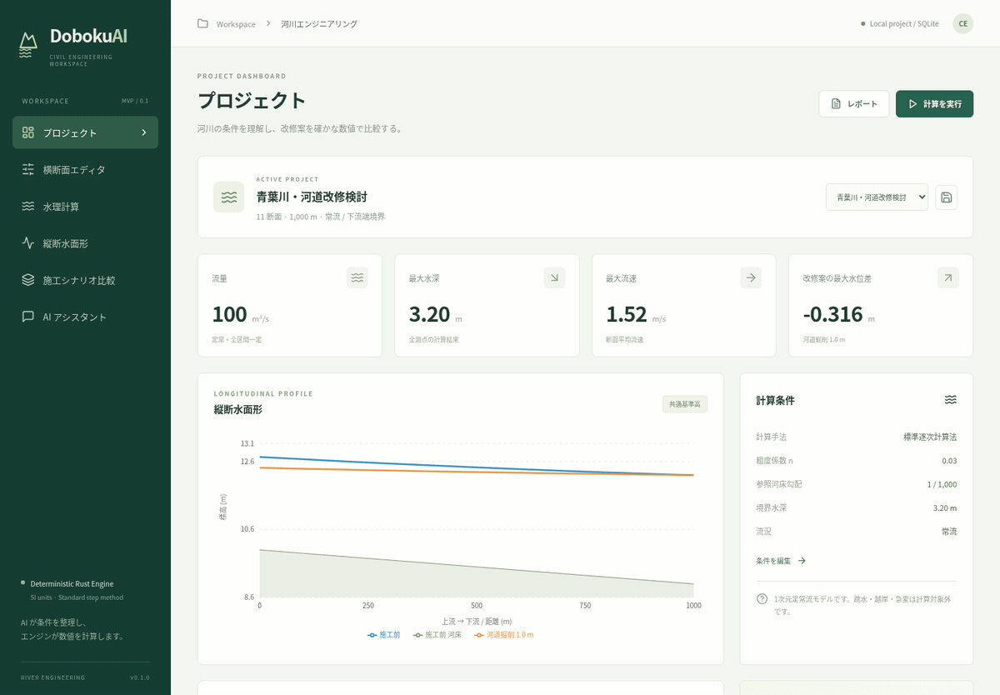

### 横断面を編集

底幅・法勾配を変更すると横断図に即座に反映。台形と矩形を切り替え、全測点への形状反映を確認できます。

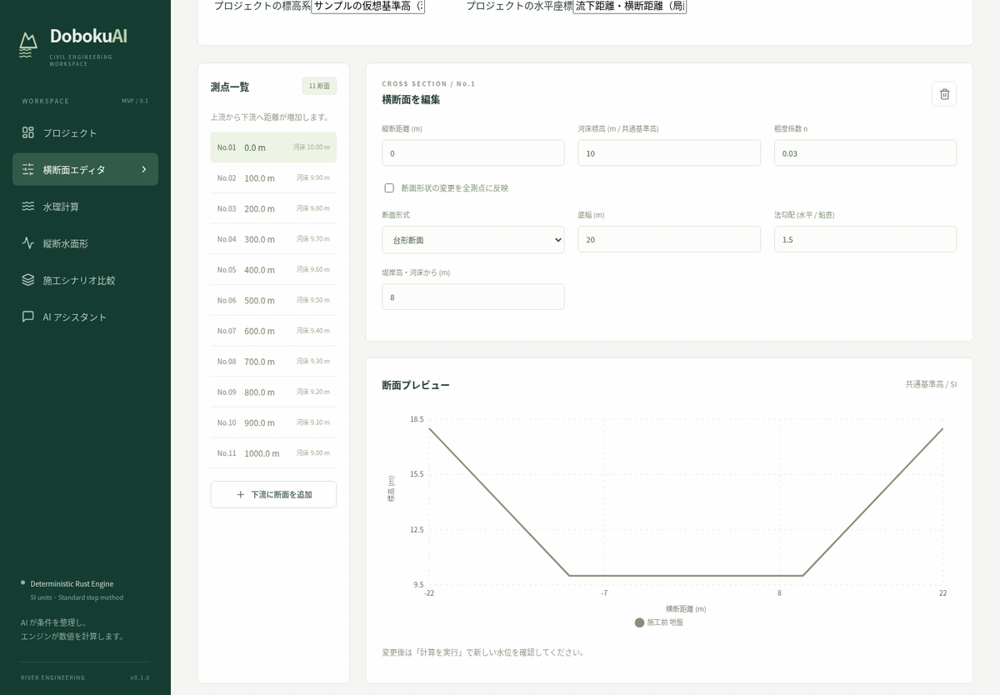

### 水位・水深・流速を確認

縦断図の表示量を切り替え、測点を選んで施工前後の横断図を確認。同じ基準高で比較します。

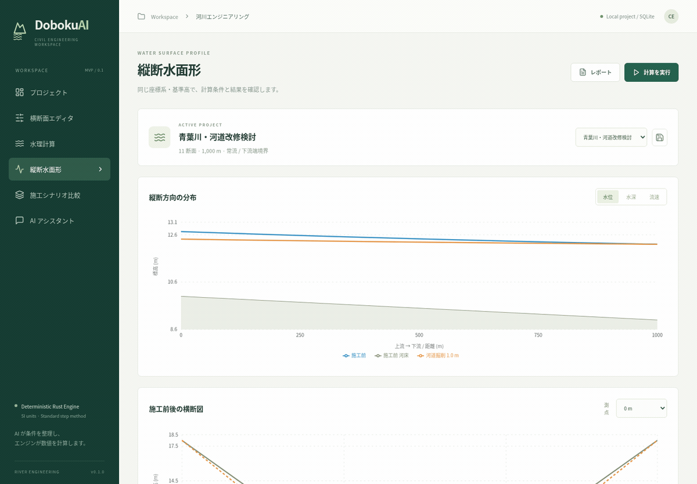

### 掘削案と水位・土量を比較

0.5 mと1 mの掘削案を実行し、横断形状・水位差・概算土量を比較します。

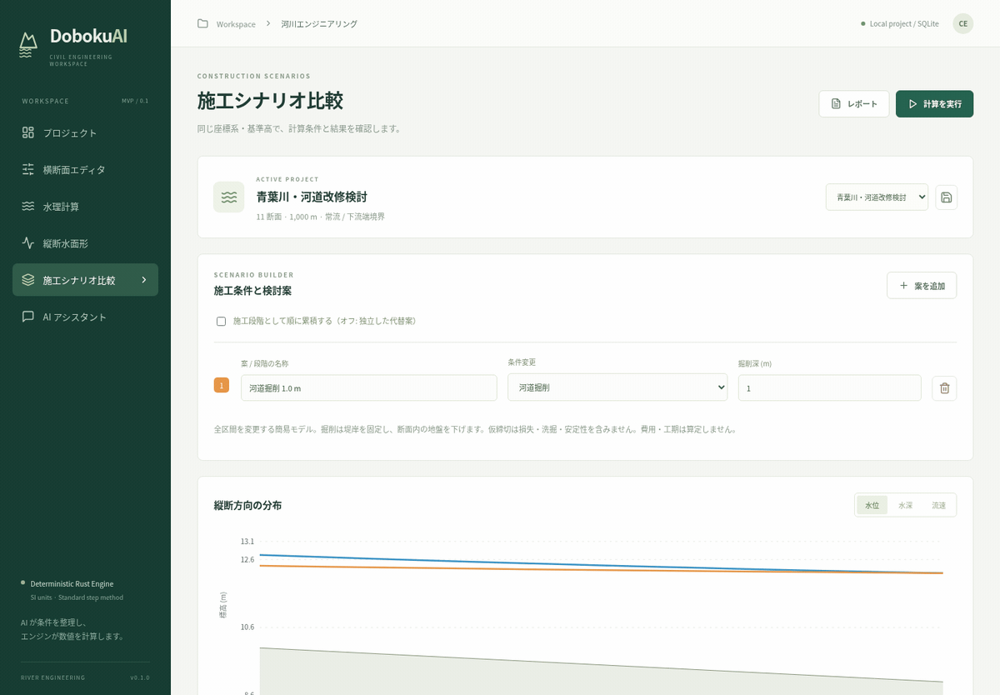

### 測点間隔による結果差を照査

線形補間の前提を確認して2分割・4分割を実行。同じ元測点の水位差を比較し、SQLite履歴から元の結果をJSON/CSV/HTMLで保管できます。

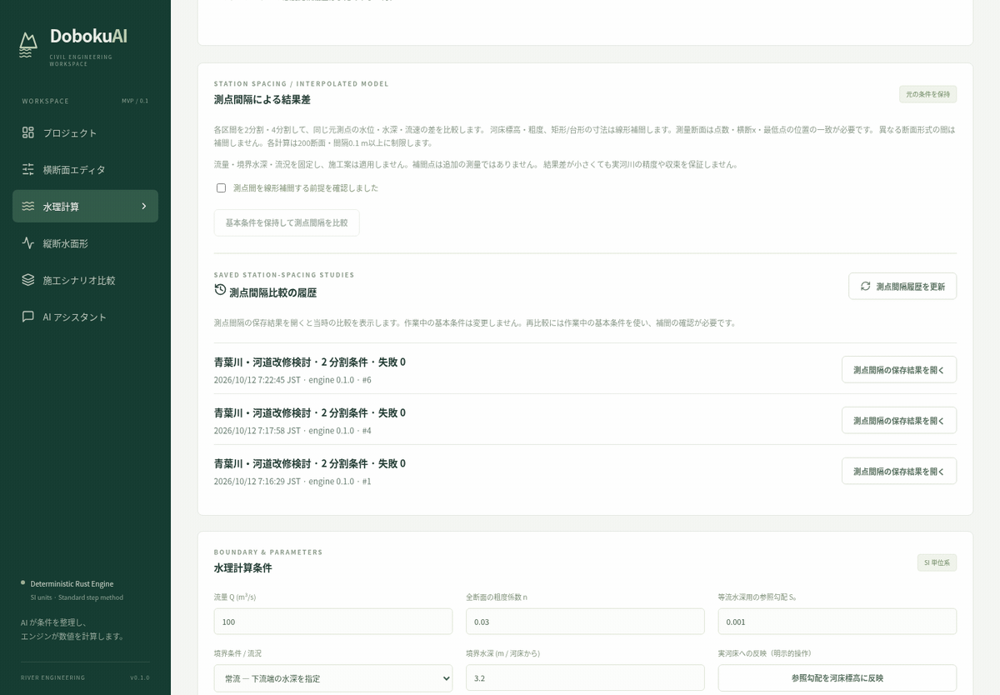

### 感度比較から履歴・レポートへ

基本条件を保持して流量・粗度を比較。結果はSQLite履歴に保存し、元の数値・日時でHTML/CSV/JSONに出力できます。

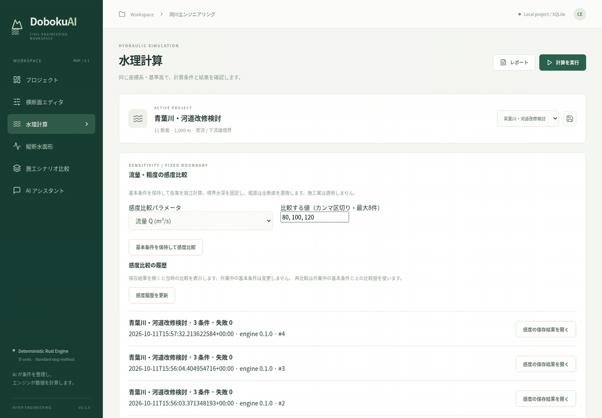

### 自然言語の操作提案を確認して適用

粗度変更の提案を確認してから再計算し、比較図を表示します。条件解釈とRustによる数値結果を区別しています。

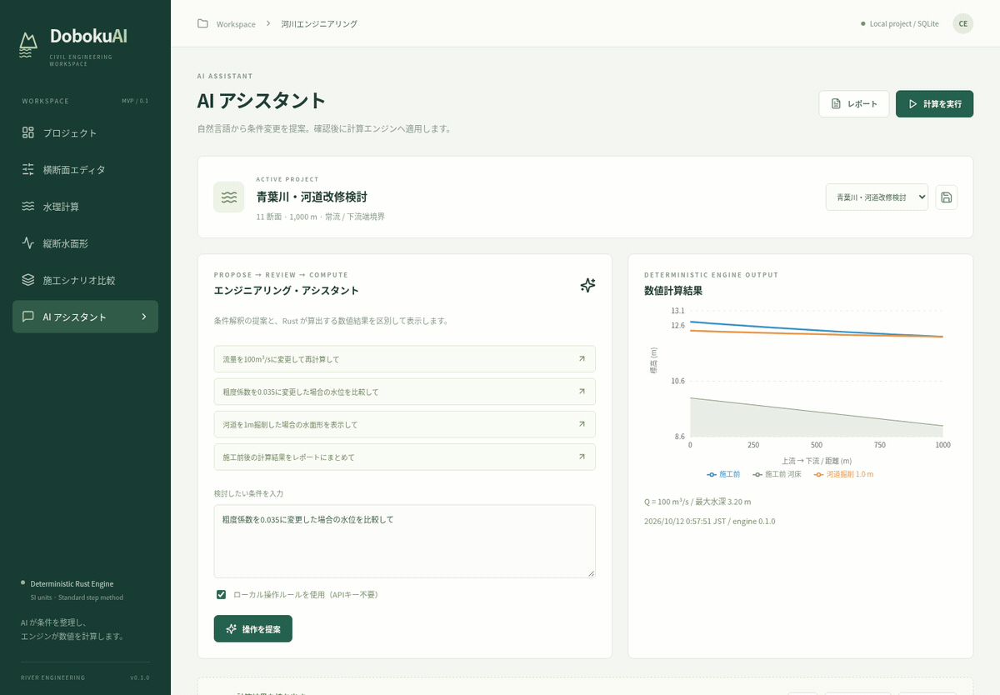

### 取込みデータの出典を残す

CSVの出典・利用条件・処理手順を記録し、プレビューを確認して反映。測量日などの未記録項目も成果に残します。

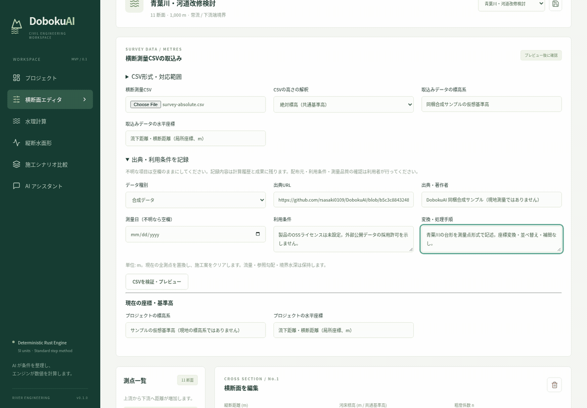

</details>

GIFの撮影・更新手順は [実画面デモの再生成](docs/readme-demos.md) を参照してください。

## 起動

### Docker Compose

Docker Engine + Compose v2 を用意し、リポジトリ直下で実行します。

```sh
docker compose up --build -d
python3 scripts/smoke.py http://127.0.0.1:8080
docker compose logs -f
```

ブラウザでポート **8080** を開きます。初回から青葉川のサンプルと 1 m 掘削案を計算・表示します。
API は Compose 内部で使用し、公開する Web ポートは既定で loopback に限定しています。
SQLite は `river-data` volume に保存します。`docker compose down` はデータを保持します。
Web ポートは `WEB_PORT` で変更できます。

クラウド/社内プロキシで正規 CA が必要な場合は、提供された公開 CA バンドルを指定します。
秘密鍵や API キーをこのファイルに指定しないでください。TLS 検証は常に有効です。

```sh
BUILD_CA_FILE=/path/to/trusted-ca-bundle.pem bash scripts/compose.sh up --build -d
```

BuildKit の CA マウントは任意です。設定がなければ標準の Docker Compose だけでビルドできます。
CAはイメージ層に保存せず、上のスクリプトではAPI実行時も公開CAバンドルを読取り専用でマウントします。
このクラウドでは `BUILD_CA_FILE="$SSL_CERT_FILE"` を使用して検証しています。

### ローカル開発

必要なもの: Rust **1.90.0**（`rust-toolchain.toml`）、Node **24**（Vite は Node 22.12 以上にも対応）、npm、C コンパイラ、Python **3.11以上**。

```sh
cargo build --workspace --locked
npm ci --prefix apps/web
```

別々のターミナルから起動します。

```sh
# ターミナル 1: API / SQLite
cargo run --locked -p doboku-api

# ターミナル 2: Vite（/api を API に転送）
npm run dev --prefix apps/web -- --port 5173 --strictPort
```

ブラウザでポート **5173** を開きます。Linux では `bash scripts/dev.sh` で両方を起動し、機能チェックまで行えます。
Ctrl-C で同スクリプトが起動したプロセスのみを終了します。
クラウド内に Rust が未導入なら `bash scripts/cloud-install.sh` を実行します。
`scripts/run-cargo.sh` は通常の Cargo、またはクラウド用 `/workspace/.toolchains` を選びます。
各タスクの既存チェックアウトを使います。追加の Git worktree は不要です。

## 操作

1. ダッシュボードでサンプルの計算条件と結果を確認。
2. 横断面エディタで測点、標高、粗度、矩形/台形/任意測量断面を編集。全断面への形状反映も可能。
3. 水理計算で流量、境界流況、水深、参照勾配を指定して「計算を実行」。条件変更時は古い結果を表示しません。
4. 施工比較で掘削・断面変更・幅閉塞の仮締切・粗度変更を登録。独立案、または順序付き累積施工段階として最大 6 案を計算。
5. 縦断の水位/水深/流速と同一基準高の横断図で比較。3D は空間的連続性の参考表示のみ、既定は 2D。
6. プロジェクトを保存すると河川条件・施工案・段階モードを SQLite に保存。複製による新規作成と再読込も可能。
7. 「計算を実行」と確認済み AI 操作の成功結果は SQLite の計算履歴に追加。ダッシュボードの「保存結果を開く」で、当時の条件・施工案・段階モード・結果を作業画面に復元します。プロジェクトの保存内容は変更しません。
8. CSV、図入り HTML レポート、再現用 JSON を出力。HTML はブラウザから印刷/PDF 保存可能。保存結果の表示中は元の結果・実行日時で出力します。それ以外の CSV/HTML は現在の条件を再計算します。

履歴はプロジェクト ID ごとに新しい順で 20 件ずつ表示します。未保存の複製にも履歴を作れますが、次回に一覧から選ぶにはプロジェクトも保存してください。
初回表示のサンプル計算、失敗した計算、プレビュー `/compare`、レポートだけの再計算は履歴を作りません。
条件を編集すると保存結果の表示を解除します。再実行は現在のエンジンで新しい履歴を作り、過去の履歴を上書きしません。
履歴の自動削除・保存容量上限・将来の結果スキーマ移行は未実装です。
オンラインバックアップと新規パスへの復元は [recovery](docs/recovery.md) の手順を参照してください。

横断面エディタのCSV取込みは、単位m・絶対/相対標高・基準高を指定し、プレビュー後に
確認して全測点を置換します。診断があるデータは反映しません。元CSVのハッシュと取込み条件を
プロジェクト・履歴・成果に記録します。データ種別・出典・利用条件・測量日・変換手順も
任意で記録でき、未記録は明示します。利用条件や測量品質の自動認証は行いません。座標変換は未対応です。
[survey-absolute.csv](examples/survey-absolute.csv) は合成サンプルです。
水理計算画面では流量・粗度の感度比較を1〜8条件で行い、失敗案の理由も表示します。
感度比較は専用のSQLite履歴に保存し、過去の比較を元の数値・日時でJSON/CSV/HTML出力できます。
感度履歴を開いても作業中の基本条件は変更しません。CSVの失敗案は数値を空欄にします。
基本断面・境界水深を固定して独立計算し、基本条件を変更しません。
詳細と入力仕様は [survey import / sensitivity](docs/survey-import.md) を参照してください。

水理計算画面の「測点間隔による結果差」では、補間の前提を確認してから区間を2分割・4分割し、
同じ元測点の水位・水深・流速差を比較できます。元の条件・流量・境界を保持し、
追加点は線形補間です。追加測量や実河川の精度保証ではありません。
失敗案は理由を表示し、数値を生成しません。表示結果は日時・エンジン版・補間後の全条件付きJSONと、
元測点での比較CSV・図入りHTMLに出力します。Webの比較はSQLite履歴に保存し、
再読込み後も同じ条件・数値・版・日時で出力できます。履歴を開いても作業中の条件は変わりません。
対応する断面の組合せと検証結果は [測点間隔の比較](docs/station-spacing.md) を参照してください。

## エンジンと適用範囲

単位は SI: 距離・水深・標高 m、面積 m²、土量 m³、流量 m³/s、流速 m/s。
距離は **上流 → 下流** に増加し、標高は全断面で共通のプロジェクト基準高です。

Manning 式:

```text
Q = (1/n) A R^(2/3) sqrt(Sf), R = A/P
Fr² = Q² T / (g A³), g = 9.80665 m/s²
E = z + y + Q²/(2g A²)
E_up - E_down = Δx (Sf_up + Sf_down)/2
```

標準逐次計算法でエネルギー式の根を求めます。指定流況の水深区間を探索し、二分法で解き、連続する水深に近い根を選びます。
二分法は最大 120 回、水深区間幅 10⁻⁹ m、区間エネルギー残差 10⁻⁷ m 以下。有限値・収束・流況を検証します。
常流では **下流端水深**、射流では **上流端水深** が必要です。
施工比較では元の境界水位を固定し、河床変更に伴う境界水深を調整します。
参照勾配は等流水深の診断値に使います。不等流には各測点の実河床標高を使います。
参照勾配を実河床に適用するには UI の専用操作が必要です。

対象は 1 次元定常、単一流路、一定の正の流量、静水圧、エネルギー補正係数 α=1、区間ごとの一様粗度です。
測量断面は x 昇順・最低相対高さ 0 の単一谷形です。潤辺と面積は区分線形断面を水位で切り取って積分します。
限界条件の複数根または段差による不連続を検出した断面は拒否します。

次の条件はエラーとなります。

- 入力の非有限値、Q≤0、粗度 n が 0.005〜0.2 の範囲外、断面数が 2〜200 の範囲外。
- 参照勾配が 0 以下または 0.1 を超える、流量が 10⁶ m³/s を超える。
- 測点間隔 0.1 m 未満、実河床勾配の絶対値 >0.1、隣接断面の基準水深での幅変化 >25%。
- 越岸、堤岸内に必要な限界/等流水深が存在しない、指定流況で解が見つからない、残差が許容値を超える。
- 限界流付近（常流 Fr≥0.98 / 射流 Fr≤1.02）、混在する流況。

**跳水・急縮拡・構造物の局所損失・複断面分流・曲線流・横流入・非定常流・土砂移動は未対応。**
幅/勾配のガードだけでは実際の断面遷移が緩やかなことを保証できません。
ユーザーは測量、境界条件、断面遷移、測点間隔を確認し、必要に応じて別の解析モデルと独立照査を使用してください。
河床の逆勾配も実標高として計算できますが、等流水深の参照勾配は正である必要があります。

## 施工・土量モデル

掘削は全測点に適用します（0 < 深さ ≤10 m）。矩形は壁を延長、台形は固定された堤岸へ新しい河床を接続し、測量断面は両岸を固定して内部頂点を下げます。
掘削断面積/盛土断面積は共通 x・基準高の地盤差を積分し、測点間の平均断面法で体積を算出します。掘削と盛土を相殺しません。
測量範囲が一致しない断面変更では、水理比較を行い、土量は理由付きで「未算定」と表示します。
仮締切は矩形/台形の底幅を減らす水理的な代理モデルです。堰・構造物損失・洗掘・安定性・仮締切材料数量を評価しません。
累積モードの水位差/土量は施工前からの累積変化です。土量は施工前後の地盤差であり、中間段階で掘って埋め戻す作業量を合計する機能はありません。
歩掛・単価の根拠が未提供のため、工期・費用は実装していません。

## AI 操作

キーがなくても計算と可視化は全機能動作します。既定はローカル操作ルールです。

- 「流量を100m³/sに変更して再計算して」
- 「粗度係数を0.03に変更した場合の水位を比較して」
- 「河道を1m掘削した場合の水面形を表示して」
- 「施工前後の計算結果をレポートにまとめて」

ローカルモードは曖昧な複数条件を推測せず、1 条件ずつ提案します。
提案は閉じた型付きツール（流量変更、粗度比較、掘削比較、レポート）だけです。
確認ボタンを押すまで条件は変わりません。API も `confirmed: true` を要求します。
計算に失敗した提案は UI の条件に反映されません。適用後の保存はユーザーが明示的に行います。

任意の OpenAI-compatible chat-completions API を使うには `.env.example` を参考に次を設定します。

| 変数 | 内容 |
|---|---|
| `LLM_ENDPOINT` | HTTPS の完全な chat-completions URL |
| `LLM_MODEL` | 使用モデル ID |
| `LLM_API_KEY` | API キー（環境設定から安全に入力） |

通常の Cargo 起動ではプロセス環境に設定、Compose は `.env` を読み込みます。
UI の「ローカル操作ルール」をオフにすると設定済みプロバイダを使用します。未設定ならローカルにフォールバックします。
モデルには自然言語の指示のみを送信します。プロジェクト全体・数値結果は送信しません。
HTTP アダプタは `Provider` インターフェースの一実装です。Anthropic/Gemini の独自形式アダプタは未実装。
LLM 応答は JSON とツール型を検証し、任意コードは実行しません。モデルによる工学的自由作文は計算レポートへ混入させません。
外部 LLM の実認証通信は API キー未設定のため未検証です。
ローカル模擬HTTPサーバーでリクエスト契約・型不適合・認証/レート制限・サイズ超過・タイムアウトを検証します。
これは実プロバイダへのTLS/認証接続の検証とは別です。公開ProviderはHTTPS必須を維持します。

## テストと検証

```sh
cargo fmt --all --check
cargo clippy --workspace --all-targets --locked -- -D warnings
cargo test --workspace --locked
npm run typecheck --prefix apps/web
npm run build --prefix apps/web

# ブラウザを用意（既存 Chromium は CHROMIUM_PATH で指定可能）
cd apps/web
npx playwright install chromium
npm run test:e2e
```

Linux/クラウドでは `bash scripts/check.sh` で一括実行できます。E2E は実 Axum/SQLite と Vite を起動します。
専用ポート 3101/5273 と実行ごとの DB を使用し、既存開発サービスを再利用しません。
`CHROMIUM_PATH=/usr/bin/chromium` を使って検証しました。CI では Chromium をインストールします。
`E2E_BASE_URL`を指定すると既存配布版に対して同じE2Eを実行します。
このテストは合成プロジェクトと履歴を保存するため、専用の試験DBを持つ配布環境で実行してください。

| 対象 | 検証と許容誤差 |
|---|---|
| 矩形限界水深 | 解析解 `(Q² / (g b²))^(1/3)` と 10⁻⁸ m 未満 |
| Manning / 等流水深 | A=20, P=14 の独立評価値、逆計算 10⁻⁸ m 未満 |
| 常流・射流の等流 | 縦断標準逐次計算で一様水深を 10⁻⁷ m 未満で再現 |
| 非一様な常流水面形 | 独立 GVF 微分方程式 RK4 と比較。10 m 間隔の最大水深差 <5×10⁻⁵ m、100 m 間隔より20倍以上改善 |
| 非一様な射流・台形/測量常流・徐拡 | 独立した連続エネルギーODEの6ケース。水深差 <10⁻⁴ mまたは5×10⁻⁵ m、細分化で約25〜64倍改善。測量頂点の水面横断も確認 |
| 外部SWASHESの矩形B1常流/射流 | 重力差を明示的に正規化し、最大水深差 <10⁻⁴m、45→177点で4倍以上改善。外部河床出力も別に細分化検証 |
| 任意測量断面 | 台形の面積/潤辺/水面幅・水面形と一致、不連続限界条件を拒否 |
| 土量・施工 | 既知の矩形柱 20,000 m³、固定堤岸台形掘削 32,000 m³、正負地盤差、段階施工、仮締切未算定 |
| API | 入力/流況エラー、11 断面結果、SQLite 再接続、段階条件、確認必須ツール、履歴の完全一致・ページング・保存結果の CSV/HTML |
| ブラウザ | 断面編集→流量変更→比較→出力→SQLite再読込、AI確認と越岸拒否、履歴の条件復元・元の日時で出力 |

RK4 参照は `tests/reference_gvf.py`、固定データは `examples/reference-gvf.json`。
`python3 tests/reference_gvf.py` で再生成し、0.05/0.025 m の RK4 刻みの差が 10⁻¹⁰ m 未満であることを確認します。
これはモデルを限定した数値検証です。現地河川の設計妥当性や実測との校正を証明するものではありません。
`docs/validation.md` に実行結果を記録しています。
追加6ケースの条件・誤差・再現方法は [hydraulic reference cases](docs/hydraulic-reference-cases.md) を参照してください。
`python3 tests/reference_cases.py --check` で独立した参照値を再生成照合します。`scripts/check.sh` にも含まれます。
公開SWASHESの外部参照2ケースもCargoテストに含めます。計測された最大水深差は約2.3×10⁻⁵m。
原流量/粗度と正規化した比較条件、外部河床出力の誤差、取得/再生成方法は
[SWASHES validation](docs/swashes-validation.md) を参照してください。外部ツールは製品に同梱しません。
参照の再生成照合はLinux x86_64で `python3 tests/swashes_reference.py --download --check`。
保存済み参照との通常のCargoテストはネットワークなしで実行できます。

## API / 構成

全計算クレートは HTTP・SQLite・LLM を必要とせず単独利用できます。詳細は [architecture](docs/architecture.md)。

```text
apps/web                       React / Vite / Recharts / optional R3F
crates/doboku-core              SI データ型・エラー・サンプル
crates/doboku-geometry          測量断面・潤辺・面積
crates/doboku-hydraulics        Manning・標準逐次計算
crates/doboku-earthwork         掘削/盛土断面積・平均断面法
crates/doboku-planning          施工変換・比較
crates/doboku-agent             型付き提案・Provider
crates/doboku-api               Axum・SQLite・レポート
examples/ tests/ docs/ docker/  データ・独立検証・仕様・配布
```

API は既定で `127.0.0.1:3001`、DB は `.local/doboku.sqlite`。`API_BIND` / `DATABASE_PATH` で変更できます。

| エンドポイント | 操作 |
|---|---|
| `GET /api/health`, `/api/sample` | ヘルス、サンプルプロジェクト |
| `GET/POST /api/projects`, `GET /api/projects/{id}` | プロジェクト一覧・保存・読込 |
| `POST /api/simulate` | River → 条件スナップショット付き Run |
| `POST /api/compare` | `{project, scenarios, staged}` → 全結果 |
| `POST /api/imports/survey/preview`, `/apply` | 横断測量CSVの診断・確認後の置換（保存・計算は別） |
| `POST /api/sensitivity` | 基本条件固定の流量/粗度比較、成功と失敗を個別出力 |
| `POST /api/resolution` | `{project, confirmed_interpolation:true}` → 基本計算と2/4分割の結果差（保存なし） |
| `POST /api/resolution/runs` | 確認済みの測点間隔比較をサーバーで計算・保存。`{id,comparison}` |
| `GET /api/projects/{id}/resolution-runs?before={cursor}` | 測点間隔比較の履歴概要を20件 |
| `GET /api/resolution/runs/{id}`, `/reports/{csv\|html}` | 保存した測点間隔結果・成果の取得（再計算なし） |
| `POST /api/sensitivity/runs` | 感度比較をサーバーで計算し、履歴へ保存。`{id,comparison}` |
| `GET /api/projects/{id}/sensitivity-runs?before={cursor}` | 感度履歴の概要を新しい順で20件 |
| `GET /api/sensitivity/runs/{id}` | 保存時の条件・数値・失敗理由・版・日時 |
| `GET /api/sensitivity/runs/{id}/reports/{csv\|html}` | 保存された感度比較の成果出力（再計算なし） |
| `POST /api/runs` | 比較と同じ入力 → 計算成功時に履歴保存、`{id, analysis}` |
| `GET /api/projects/{id}/runs?before={cursor}` | 新しい順の履歴概要20件、`{items, next_before}` |
| `GET /api/runs/{id}` | 保存した条件と数値結果を再計算せず取得 |
| `GET /api/runs/{id}/reports/html`, `/csv` | 保存結果と元の実行日時で出力 |
| `POST /api/agent/propose` | `{prompt, local}` → 型付き提案 |
| `POST /api/agent/apply` | `{project, scenarios, staged, proposal, confirmed}` → 再計算 |
| `POST /api/reports/html`, `/api/reports/csv` | 比較と同じ入力 → 図入り HTML / 全案 CSV |

エンジンの入力/適用範囲エラーは 422、AIの未確認操作は 409、間隔比較の未確認補間は 422、計算過多は 429。
JSON ボディ上限 256 KiB、計算同時実行 4 件。計算は Tokio の blocking pool で実行します。
レポートは全条件、全横断図、縦断水面形、水深/流速、施工比較、注意、エンジンバージョン、UTC 実行日時を記録します。
認証・チーム共有・本番運用監査・河川以外の解析は未実装です。
開発状況と完成度の判断基準は [development status](docs/development-status.md) に記録します。
類似製品との比較、成熟度の評価基準、開発優先順位は [product research](docs/product-research.md) を参照してください。
